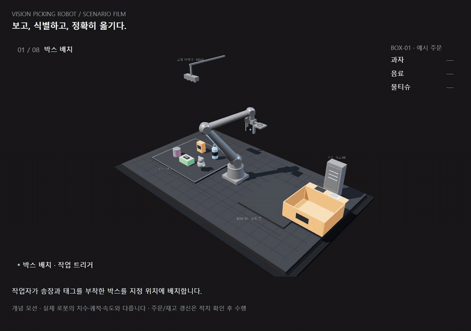

  

<strong>물체를 보고, 태그를 읽고, 목적지로 옮깁니다.</strong>

---

RFID로 박스와 주문을 연결하고, 비전으로 주문 상품을 찾아 로봇팔로 피킹·패킹하는 시스템을 개발합니다.

**동작 흐름**

박스 배치 → RFID로 박스 식별 → 주문·수량 조회 → 비전 검출·좌표 변환 → 피킹·적치 → 수량 확인·반복 → 홈 복귀

  

시나리오 개념 모션이며 실제 장비의 치수·궤적과 다릅니다. 이미지를 누르면 MP4 원본을 받을 수 있습니다.

Python · PC/SC · FastAPI · SQLite · Ultralytics YOLO
