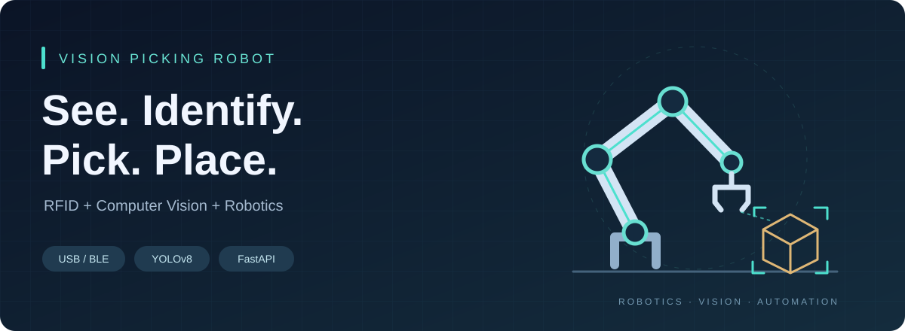

  

<strong>물체를 보고, 태그를 읽고, 목적지로 옮깁니다.</strong>

  <a href="https://github.com/vision-picking-robot/demo-repository"><b>프로젝트 저장소</b></a> ·
  <a href="https://github.com/vision-picking-robot/demo-repository/blob/main/robot_rfid/README.md">시작하기</a> ·
  <a href="https://github.com/vision-picking-robot/demo-repository/issues">이슈</a>

---

RFID로 작업 정보를 확인하고, 비전으로 물체를 찾아 로봇팔로 분류·적치하는 시스템을 개발합니다.

**프로젝트 저장소**

**[RFID · Vision Pick-and-Place →](https://github.com/vision-picking-robot/demo-repository)**

6축 로봇팔, YOLOv8 비전, 그리퍼에 장착된 RFID 리더기를 연결하는 프로젝트입니다.

| 구성 | 내용 |
|---|---|
| RFID | ACR1555U USB·Bluetooth LE 태그 UID 읽기 |
| 데이터 | SQLite 기반 제품·목적지 상자 매핑 |
| API | FastAPI 제품 조회, 작업 큐, WebSocket 알림 |
| 비전·로봇 | YOLO 클래스 매칭, 좌표 변환, 피킹 상태 머신 |

**[코드 보기](https://github.com/vision-picking-robot/demo-repository/tree/main/robot_rfid)** · **[설치 및 실행 방법](https://github.com/vision-picking-robot/demo-repository/blob/main/robot_rfid/README.md)** · **[이슈 등록](https://github.com/vision-picking-robot/demo-repository/issues)**

**동작 흐름**

박스 배치 → RFID 스캔 → 제품·목적지 조회 → 비전 검출 → 피킹·적치 → 홈 복귀

**현재 진행 상태**

- USB·BLE를 통한 태그 5종 읽기와 DB 매핑 조회 확인
- API·작업 큐 및 로봇 동작 시뮬레이션 구현
- 실제 제품 비전 학습, 현장 캘리브레이션 및 로봇 연동 예정

Python · PC/SC · FastAPI · SQLite · Ultralytics YOLO
